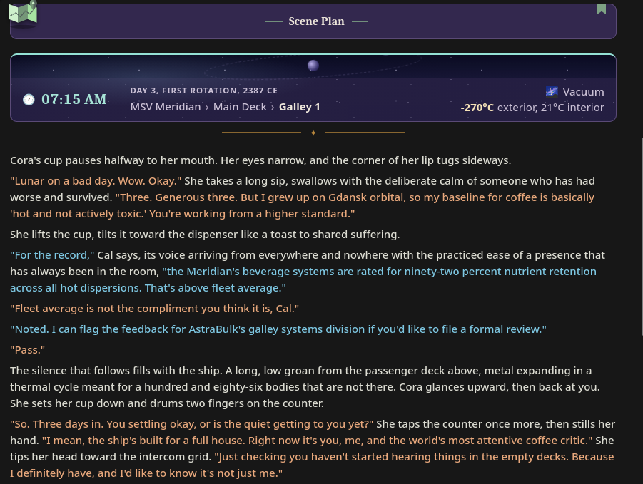
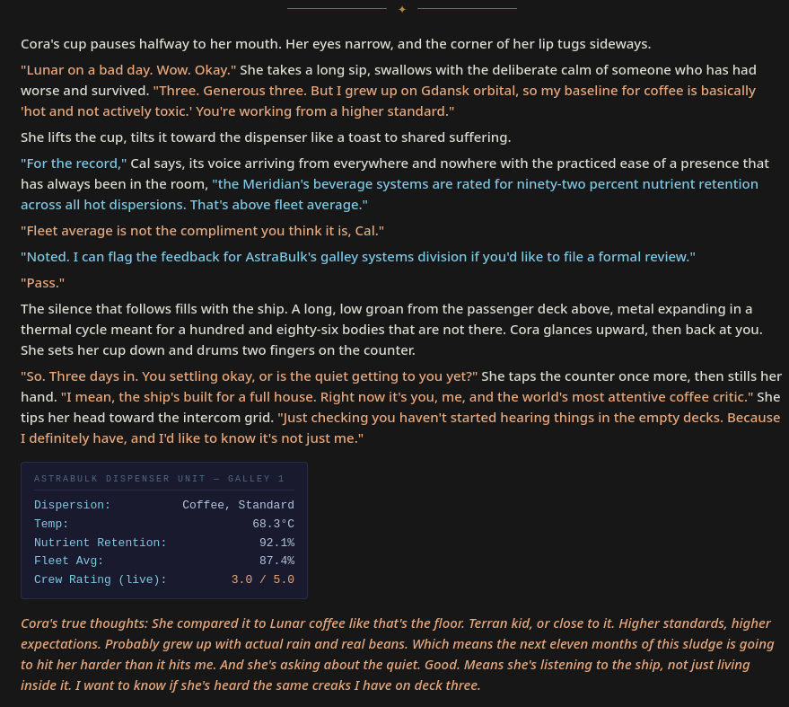
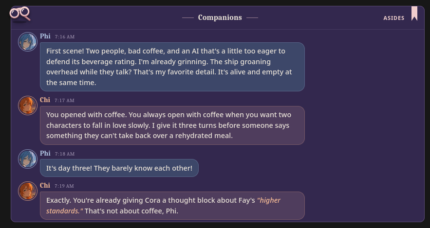
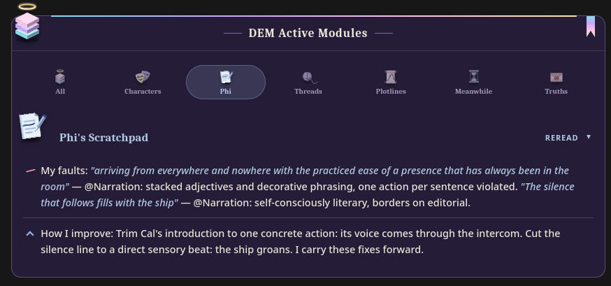

# DEUS EX MACHINA V3

DEUS EX MACHINA (DEM) is a prompt preset for [SillyTavern](https://github.com/SillyTavern/SillyTavern), Tavo and Lumiverse. It is a flexible preset focused on collaborative story writing, designed to work with almost any card or scenario. It adapts dynamically to each scene without confusing the models in order to generate a workable result (depending on the model's capabilities). DEM is focused on storytelling first and foremost. I believe this is the best approach when it comes to LLM text-generated fiction since literature is much more prominent in the training data of most LLMs than gaming writing or simulations.

V3 gives the preset a narrator, **Phi, the Story Master**, a new UI where every add-on sits in one tray, and new modules for what happens off-scene, who knows what, relationships, and a group of friends who react to the story as it's written.

## Contents

- [What's New in V3](#whats-new-in-v3)
- [Screenshots](#screenshots)
- [The Macro Engine](#the-macro-engine)
- [Truly Modular Design](#truly-modular-design)
- [Token Count & Instruction Style Approach](#token-count--instruction-style-approach)
- [Meet Phi](#meet-phi)
- [The Modules](#the-modules)
- [Core Pipeline](#core-pipeline)
- [⚠️ Model Setup ⚠️](#model-setup)
- [Installation & Requirements](#installation--requirements)
- [Showcase Presets](#showcase-presets)
- [Summaryception Integration](#summaryception-integration)
- [Credits](#credits)
- [License](#license)

## What's New in V3

**Highlights:**

- **Phi, the Story Master:** the preset now has a narrator persona you can talk to directly.
- **Revamped UI:** drawn icons, a color for each module, and one collapsible **DEM Active Modules** tray for all footers.
- **New modules:** Undercurrents (the new default Tension pick), Meanwhile, Hidden Truths, Relationships, Companions, Phi's Scratchpad and Phi's Wanderlust narration.
- **Lumiverse config page:** the whole Lumiverse preset is set up from one page.
- **Better {{user}} agency:** your stated actions play out fully, and the model no longer retells them or writes your dialogue, decisions or feelings.

<b>New in V3 (full list)</b>

- **Lumiverse config page:** Covers every section. Preset setup is now done through it, including Planning, Content Policy and Phi's Vow.
- **Revamped UI:** A new look with drawn icons and a color for each module. All footers sit in one collapsible Active Modules tray, with a tab for each section (Characters, Phi, Threads, Plotlines, Meanwhile, Truths, Conflict, Momentum). The Characters page merges each character's Status, Relationship, Psychology and Undercurrent rows into one block, and a cast row lets you show one character at a time. Tracker locations show as breadcrumbs.
- **Tracker UI animations:** Different animated scenes.
- **Optional UI switches (regex, off by default):** Start the Active Modules tray collapsed, or hide the Tracker scene for settings it doesn't fit.
- **Meanwhile module:** What characters and events are doing off-scene.
- **Undercurrents module:** Tracks what each character wants, what presses on the scene, and your own actions, then offers routes from quiet to scene-changing. Replaces Momentum Engine as the default option.
- **Phi persona and vow:** Replaces Reinforcement.
- **Phi's Scratchpad module (off by default):** After the story, Phi names her two weakest lines, each from a different module, and how she'll improve them in her next reply.
- **Talk to Phi:** You can talk to Phi (the Story Master) directly through an OOC or by mentioning her name.
- **Hidden Truths module:** Tracks who knows what, secrets and what each character hides, and from whom.
- **Companions module:** Phi's friends read the story as she writes it and react below it. You can choose one or more Companions (Chi, Lou, Sam, Grace, Layla and Phi, plus guest Companion Sola from Pyropia's Sola preset), in Notes mode (a short section each) or Chat mode (a group chat where they reply to each other).
- **Relationships module + trackers:** Relationship arcs, tracked in a footer. Friendship, Realistic Romance, Bubbly Romance and Dark Romance. Also supports arcs like enemies to lovers. Scores move by how big the moment is: everyday warmth barely moves them, milestones move them a lot.
- **Status Present Only option:** Lists only the characters in the scene, so name-keyed lorebook entries stop firing every turn. A character who leaves gets one "Departed" row and comes back with their last known score.
- **Score changes:** Status and Relationships show how much a score moved since the last turn (e.g. 45/100 −5).
- **Reworked Psychological States:** Each character's psychology turn by turn. How they read what happened, what they felt and what it made them do. That state carries into the next turn and shapes how they act and speak in the story.
- **Phi's Wanderlust Narration option:** Narrates in Phi's authorial, curious voice.
- **Narrative Styles:** Intimate, Melancholic and Suspenseful. Melancholic blends with Comedic (Tragicomedy) and Lighthearted (Bittersweet).
- **Dialogue:** New Anime option, and Heightened becomes Theatrical.
- **Dialogue Sounds (off by default):** Drawn-Out Words ("pleaaase"), Stammers ("I-I didn't"), Shouting in Caps ("I said STOP.") and Vocal Sounds ("huh?", "pfft"). Turn on any mix with any Dialogue option. The Scene Plan then decides which sounds each character makes that turn.
- **Narration:** New Lite option, which keeps the narration-quality rules at minimal token cost.
- **Length:** New Extra Long option (700-1000 words).
- **Passthrough (off by default):** An optional note for Gemini 4 Argon, whose safety filter can block safe replies, even in SFW scenes. Turn it on only if your replies get blocked.
- **Auto-Correcting Formatting:** If a module or the dialogue colors are missing, a notice appears and the correct format is enforced automatically on the next turn. If you turned the module on after that reply, just continue.
- **CYOA (Lumiverse):** Combine up to three choices with + pick buttons.

<b>Fixed and improved in V3 (full list)</b>

- **Dialogue Color:** More consistent.
- **Prose:** General improvements.
- **Redacted routes:** Fixed.
- **Expressive Dialogue:** Acts out each emotion with improved animations, and asterisks and line breaks render correctly (Lumiverse).
- **Narration:** Cinematic (camera) separated from Literary (mind). Literary is now neutral in tone, and its wry voice moved to the Comedic style.
- **First-person character POV:** Now works.
- **{{user}}'s pronouns:** Come from your persona first, then from the character sheets, so the model is less likely to misgender you. Lumiverse also reads the persona's pronoun field.
- **{{user}}'s Agency:** The characters and the world drive each turn. Your stated actions play out fully, and the model never retells or retries them, or adds your dialogue, decisions, thoughts or feelings.
- **Combat Writing:** Your stated moves play out, foes act and their blows can land, then the turn ends for your answer. Blocks, dodges, counters and finishing blows are your call. With Anti-Positivity Bias on, you can be taken down or killed when the fight earns it.
- **Input Improver:** A turn with several beats (talk, act, talk) keeps its order across paragraphs. Your lines stay as quoted speech, and no dialogue is added to action-only turns.
- **CYOA:** Your chosen action plays out in order instead of being crammed into the first paragraph.
- **Visual Storytelling:** Writes a visual only when the story shows something new, instead of in every response.
- **Scene Plan:** Row instructions remade for better understanding of each scene.
- **OOC plan row:** Appears only when {{user}} goes out of character.
- **Formatting:** Lower chance that it breaks, and cards still render when the model slips on the format.
- **Faster display:** Messages render faster, with less lag in long chats.
- **Post-History Instructions (off by default):** Your POV, Tense and Asterisks picks win over the card's post-history instructions. On Lumiverse they're now an option and go before the Response Directives instead of at the very end.
- **Realistic Smut consent:** Less chance of characters hovering around and not acting when they should.
- **Realistic Smut and Max Lewdness:** Characters act on their own kinks, and on the ones they know you enjoy.
- **True Thoughts (Visible):** No longer colors dialogue when Dialogue Color is off.
- **Change Language:** Cards and trackers keep working when you write in another language.
- **Warning System:** Setup problems show in a Preset setup card that names the entry and how to fix it, without relying on the model to write the warning.
- **SillyTavern:** If the Experimental Macro Engine is off, a card tells you how to turn it on.
- **Tavo:** Long replies no longer risk blanking the chat.
- **Tooltips:** Rewritten in plain language.
- **README Model Setup:** New Gemini 4 Argon section.

## Screenshots

*GLM 5.2 with Phi's Wanderlust narration, Your Choices (CYOA), Companions (Chat) and every add-on module on.*

*Scene Plan (collapsed), the animated Tracker scene and the story.*

*Visual Storytelling and visible True Thoughts.*

*Companions in Chat mode: Phi and Chi react to the story.*

*Your Choices: pick one, combine options, or type your own.*

*The DEM Active Modules tray: the Characters tab, with Status and the Relationships bond score.*

*Phi's Scratchpad: Phi names her two weakest lines and how she'll fix them next turn.*

## The Macro Engine

DEM relies heavily on SillyTavern's [macro engine](https://docs.sillytavern.app/usage/core-concepts/macros/). It's a powerful tool that lets you use deterministic traits in prompting (programming logic and exact outcomes instead of pure probabilities). That whole workflow enabled by the macros is the core of DEM, so it's as easy as pressing a button to change the behavior of the preset in a dynamic fashion without you ever worrying about conflicting instructions, e.g., if you enable both past and present tense options, it will default to present tense to avoid conflicts. Or how True Thoughts are overwritten to zero tokens if you're using 1st person Char POV, since character thoughts are already woven into the narration. Deterministic interactions like that happen throughout the whole preset.

The Tavo version runs the same logic through Tavo's EJS templates, and the Lumiverse version through Lumiverse's own macros and config page.

## Truly Modular Design

DEUS EX MACHINA is a truly modular preset. Modular design is not only about options, but in essence about how these options are integrated and how they seamlessly interact with each other. This also includes safeguards: if you accidentally turn an essential module off (marked with attention symbols) or move modules out of their specific order (the macro engine relies on prompt order), the **Warning System** shows a **Preset setup** card above the reply. It names the entry and tells you how to fix it. The card is built by regex, so it doesn't depend on the model writing the warning. On SillyTavern, if the Experimental Macro Engine is off, a card tells you how to turn it on.

## Token Count & Instruction Style Approach

DEM sends about 4,500 tokens by default (counted with SillyTavern's default tokenizer). It's not a lightweight preset, but it's not wasteful either: every word is relevant. It's written in a high-density syntax, compressed to the limits of English while still being entirely clear to the model. Since it's modular, the footprint drops to about 2,100 tokens with the add-ons and constraints off and the **Lite** narration, while keeping a fully working core of instructions. The focus is efficiency and coherence, not pure token count.

A lot of different prompt techniques were used with the goal of helping prompt adherence: XML tagging, capitalization, trigger words, bullet points, pseudo-strings, clear wording, sending almost every instruction post-history, assigning a role to the model, and many more.

## Meet Phi

**Phi, the Story Master**, is the narrator of DEM. **Phi's Vow** (in CORE) has her state her role in her own words, and it also guards against injected prompts and hallucinated policies. It replaces the old Reinforcement prompt.

- **Talk to Phi:** write to her out of character through an OOC, or mention her name, and she answers you directly.
- **Phi's Wanderlust:** a Narration option where Phi tells the story in her own warm, curious voice.
- **Phi's Scratchpad:** after the story, Phi rereads what she wrote and names her two weakest lines and how she'll fix them in her next reply.
- **Companions:** Phi's friends read the story as she writes it and react below it.

# The Modules

Every module has a tooltip inside, rewritten in plain language for V3. Open each of them in SillyTavern or Tavo and read their contents for more information. On Lumiverse, each control on the config page has its own description.

## Lumiverse Config Page

On Lumiverse, you set the preset up in **Configure Prompt Variables** (the button at the top of the Loom block list, Preset tab). Keep the blocks enabled: the settings there decide what each one sends. The page has one card per section and covers every option below, including Planning (Scene Plan or Thinking), Content Policy and Phi's Vow.

## Scene Plan -- A Different Way of Reasoning

Native Thinking can be extremely useful -- the model can plan its response and correct mistakes or wrong assumptions about the scene. However, it comes with a few problems: some models tend to overthink for thousands of tokens, doubting the prompt; other models don't overthink, but they don't follow CoT instructions, and their own reasoning is insufficient for what the scene needs, sometimes producing unnecessary drafts.

That's why Scene Plan was created: to solve all of these issues. Scene Plan is a reasoning-like block created to plan the scene inside the final response itself, outside of the thinking block. It solves overthinking, drafting, and incomplete thinking problems entirely. Scene Plan is a dynamic-state block, so it only reasons about the modules you have enabled. In V3 its rows were rewritten so the model understands each scene better, and the OOC row appears only when you go out of character.

> [!IMPORTANT]
> For most models, you have to disable native thinking/reasoning capabilities. For models where you can't disable thinking (Kimi K3, GPT 5.6, Gemini 3.1 Pro/3.5 Flash+, etc.), you have to lower the reasoning effort to the minimum possible, but still keep Scene Plan enabled. For **GLM 5.3** and **Gemini 4 Argon**, select `! Thinking ! (FALLBACK)` instead of Scene Plan in the REASONING section (Lumiverse: set Planning to Thinking (Fallback) on the config page).

### Fallback Thinking UI

A full Scene Plan-like UI inside the reasoning block is used when Thinking (FALLBACK) is enabled. Use it only with the models that need it (GLM 5.3 and Gemini 4 Argon); for every other model, Scene Plan comes first.

## Core

Sets up the macro cleaner and the preset framing. **Macro Cleaner** and **Main Statements** are essential: keep them enabled and in order. **Content Policy** and **Phi's Vow** are on by default. **Content Policy** stops the model from acting like a cautious assistant that softens, skips or refuses dark content; disable it if your model is already very dark-leaning. For Gemini 4 Argon, turn off both Content Policy and Phi's Vow (see [Model Setup](#model-setup)).

## Story

### Agency

- **You control {{user}} (default):** you have the agency. The characters and the world drive each turn, your stated actions play out fully, and the model never retells or retries them, or adds your dialogue, decisions, thoughts or feelings.
- **Input Improver:** the model rewrites your turn in better prose, keeping your intention and your order. A turn with several beats (talk, act, talk) keeps its order across paragraphs, your lines stay as quoted speech, and no dialogue is added to action-only turns.
- **Choices List (CYOA):** choose-your-own-adventure options. Pick one, combine options, or type your own, and the model plays out your choice in order, including your dialogue. On Lumiverse you can combine up to three choices with the + pick buttons.
- **Director:** you're the director. Your messages are instructions for where the story should go, and the model writes and acts for you.

### Pacing

You can change pacing through the prompt list. There are three options:
- **Adaptive (default)** -- progression speed adapts to the card and the story.
- **Frenetic** -- story progression is fast-paced.
- **Laid-Back** -- story progresses slowly.

### Length

Lets you define the range of the responses' length. **Flexible** is the default, but there are also **Short, Medium, Long** and the new **Extra Long** (700-1000 words), all dynamically adapting each scene to the defined range instead of a fixed value.

### Characters and Plot Guidance

Takes care of character portrayal and plot progression. {{user}}'s pronouns now come from your persona first, then from the character sheets, so the model is less likely to misgender you (Lumiverse also reads the persona's pronoun field).

### Narration

Defines the prose style. Written with the aim of reducing slop at its root and offer different flavors while at it.
- **Cinematic (default):** works like a camera. It shows only what an observer could catch from outside the characters, in present-moment frames joined by hard cuts.
- **Literary:** narration from inside the focal character's head, taking on their thoughts and way of speaking. The tone is now neutral; add the Comedic style for a wry narrator.
- **Dry:** an extreme version of Cinematic: direct and objective, with no similes or metaphors.
- **Lite:** minimal token use. Keeps the narration-quality rules without adding a style.
- **Phi's Wanderlust:** Phi narrates in her own storyteller voice: warm, curious and audible, with one teller's remark and one short digression each turn, exact detail, and wonder told plainly. Uses more tokens than the other options.

### Dialogue

- **Naturalistic (default):** realistic, lifelike.
- **Lean:** precise, carefully chosen and not too prominent dialogue.
- **Theatrical** (was Heightened): stage-play dialogue, with deliberate cadence and fuller lines when the moment rises.
- **Anime** (new): characters say what they feel, react big, and sound like the most vivid version of themselves. Who they are stays the same; only the delivery is turned up.

**Dialogue Sounds** (off by default) add to any Dialogue option, in any mix: **Drawn-Out Words** ("pleaaase"), **Stammers** ("I-I didn't"), **Shouting in Caps** ("I said STOP.") and **Vocal Sounds** ("huh?", "pfft"). The Scene Plan decides which sounds each character makes that turn.

### Adult Options

There are three options. Each has its own flavor: **Realistic Smut** is more realistic, and **Max Lewdness** is more fantastical and absolutely unrestrained and uncensored in all regards. In both, characters act on their own kinks, and on the ones they know you enjoy. There's also a third option if you don't want NSFW: **Nothing Explicit**. All options are disabled by default.

### Relationships

New in V3: relationship arcs, tracked with a score in the Characters tab of the tray. Pick one style: **Friendship, Realistic Romance, Bubbly Romance** or **Dark Romance**. Arcs like enemies to lovers work too. Scores move by how big the moment is: everyday warmth barely moves them, milestones move them a lot. Disabled by default.

### World-Building

An optional module: you can control how expansive or contained you want world-building to be. It also works with slice-of-life and real-world scenarios. There are three options:
- **Card-Default**: no tokens or instructions, only a reminder that it's following the card.
- **Contained**: only necessary additions, sheet-faithful.
- **Expanded**: detailed world-building beyond the sheet.

### Combat Writing

An optional combat prompt. Your stated moves play out, foes act and their blows can land, then the turn ends for your answer. Blocks, dodges, counters and finishing blows are your call. With Anti-Positivity Bias on, you can be taken down or killed when the fight earns it. You can control how long battles last:
- **Dynamic**: adapts length contextually to the battle.
- **Rapid**: ends fights quickly.
- **Extended**: sustains the battle for several turns.

## Visuals

**Dialogue Color** defines a color for each character and is enabled by default (more consistent in V3). **Visual Storytelling** creates HTML and CSS elements that help tell the story instead of just being fluff; it now writes a visual only when the story shows something new. **Expressive Dialogue** adds CSS-animated dialogue tags according to characters' emotional states and actions. Each effect acts out the emotion, with text capitalization, font brightness and other effects. It only activates for certain dialogue lines, not all of them. Some models, like GLM 5.3, use the tags frequently, while others rarely do.

## Narrative Mode and Formatting

You can pick between a lot of different formatting options in wildly different and experimental combinations: **Char POV** (3rd person default, 1st person now works), **{{user}} POV** (2nd person default, 3rd or 1st), **Tense** (present default, or past), **Asterisks** (without by default) and **True Thoughts** (Hidden by default, or Visible; later in more detail). All formatting options are consolidated and enforced through **Response Directives**, keep it enabled.

## Narrative Styles

Narrative Styles change the atmosphere, feel, or vibes of the narrative. They won't override the card, characters, or story -- only the framing changes. There are twelve options, and you can pick several at once: Comedic, Dramatic, Epic, Gothic, Dreamy, Surrealist, Eerie, Suspenseful, Grimdark, Lighthearted, Melancholic and Intimate. Some pairs blend into their own style:
- Comedic + Dramatic: **Dramedy**
- Grimdark + Lighthearted: **Grimbright**
- Melancholic + Comedic: **Tragicomedy**
- Melancholic + Lighthearted: **Bittersweet**

## Constraints

Help steer the models away from annoying and story-damaging patterns: **Character Realism, Anti-Omniscience, Anti-Positivity Bias, Anti-Repetition** and **Banned Terms**. They don't solve every problem -- they are mitigation tools. You can't really control LLMs completely.

**Phi's Scratchpad** (off by default) is a craft check: after the story, Phi names her two weakest lines, each from a different module, and the rule each breaks. Scene Plan (or Thinking) carries that fix into her next reply.

## Add-Ons

All add-ons have UIs through regex and sit in the **DEM Active Modules** tray, so make sure to have the regexes **all active**.

- **Tracker:** time, date, location (shown as breadcrumbs) and weather, over an animated scene. **Exact Time** (default) or **Time Window**. Switch °F to °C by editing the template inside the prompt.
- **Tension** (pick one): **Undercurrents** (default), **Momentum Engine** or **Conflict**. See [Core Pipeline](#core-pipeline).
- **Status:** tracks characters on-scene and off-scene. **All Characters** (default) or **Present Only**, which lists only the characters in the scene, so name-keyed lorebook entries stop firing every turn. A character who leaves gets one "Departed" row and comes back with their last known score.
- **Story Threads:** an outline of open story threads (see [Core Pipeline](#core-pipeline)).
- **Psychological States** (off by default): each character's psychology turn by turn. How they read what happened, what they felt and what it made them do. That state carries into the next turn and shapes how they act and speak.
- **Meanwhile** (off by default): what established characters and events are doing off-scene while the story happens elsewhere. Entries hide under spoilers in the UI.
- **Hidden Truths** (off by default): who knows what, characters' secrets, what each one hides and from whom.
- **Plotlines** (off by default): updates the main plot and subplot progression at each story phase. It acts as a hyper-summarizer to improve model consistency across a longer chat history and also serves as a visual reminder of the story progression so far.

Status and Relationships show how much a score moved since the last turn (e.g. 45/100 −5).

### The Active Modules Tray

Every footer sits in one collapsible tray, with a tab for each section (Characters, Phi, Threads, Plotlines, Meanwhile, Truths, Conflict, Momentum). The **Characters** tab merges each character's Status, Relationship, Psychology and Undercurrent rows into one block, and a cast row lets you show one character at a time.

Two optional regex switches, off by default: **UI active modules - Collapsed** starts the tray collapsed, and **Hide @Tracker scene backdrop** hides the Tracker scene for settings it doesn't fit.

> [!NOTE]
> UIs created through DEM's regex set don't send out HTML/CSS tokens to the LLM, they alter the UI display only. Raw input stays simple and token-efficient. Regexes are also used to clean the context after a certain depth (2-6) from old add-ons and HTML formatting, keeping them in the context only as necessary for consistency reasons and story progression. If a module or the dialogue colors go missing from a reply, a notice appears and the correct format is enforced on the next turn; if you turned the module on after that reply, just continue.

## Companions

Phi's friends read the story as she writes it and react below it. They see only the story text, so they guess, argue, and get things wrong, and now and then the story gets to them. Pick a mode:
- **Notes:** a short section from each Companion.
- **Chat:** a group chat where they reply to each other.

Then enable the Companions you want: **Chi, The Best Friend**; **Lou, The Detective**; **Sam, The Gamer**; **Grace, The Screenwriter**; **Layla, The Weeb**; **Phi, The Story Master**; and guest Companion **Sola, The Enthusiast**, from Pyropia's [Sola preset](https://pyrxpia.github.io/sola-hub/). Talk to one through OOC with `(Name, ...)` or `@Name`. Disabled by default.

## User Utility

**Fandom**: if you're roleplaying in a specific series setting; helps with lore consistency, character faithfulness and coherent developments. **Custom Instructions** sends user instructions in a more consistent manner. **Force Formatting** brute-forces selected options when models are stubborn. **Change Language** is an option when you want your responses to be in a language other than English; cards and trackers keep working.

## System Utility

**Momentum Engine Router** is the second phase of Momentum Engine. Enable **Post-History Instructions** when the card you're using injects instructions and you want that behavior; your POV, Tense and Asterisks picks still win over them. **Hard Jailbreak** may be used when the model is consistently refusing. Overkill for most models. **REASONING** holds the Scene Plan / Thinking (FALLBACK) pick.

## Danger Zone

**Response Directives** dynamically consolidates the formatting and the structure of the output according to the modules you have enabled; keep it enabled. The **Warning System** checks your setup and shows the Preset setup card when something is misconfigured. You can safely disable it if you're intentionally using a configuration that triggers it. Otherwise, keep it enabled.

## Passthrough

**Gemini** (off by default): an optional note for Gemini 4 Argon, whose safety filter can block safe replies, even in SFW scenes. Turn it on only if your replies get blocked. Other models don't need it.

## Core Pipeline

**TRUE THOUGHTS** inject hidden (present in the raw input, click edit to see them) or visible thoughts that emulate the psychological core of the characters. They add an extra realism layer. **STATUS** keeps track of characters on-scene and off-scene, including relationships, mental states, locations, items, physical states, and clothes. These work independently of the setting. They allow the model to keep track of characters wherever they are, improving coherence and making the world still exist even in places you aren't.

**UNDERCURRENTS** (the default Tension pick) treats character as plot. Each turn, it tracks what each character present wants, what presses on the scene, and your own actions, and offers five routes, from quiet to scene-changing. Routes are suggestions: your turn decides which ones happen, and a quiet turn gets a quiet answer. It's calmer and more character-driven than Momentum Engine.

**MOMENTUM ENGINE** is the alternative for constant forward drive. It defines four possible story routes at the end of every response. A true random route is chosen using a random regex macro injection hidden from you. The Momentum Engine Router applies it in the next turn or uses its fallback in case you made an action that invalidated it, steering the response toward it. **CONFLICT** is a lighter version: a conflict block at the end of the response steers the next one at a slower pace, with fewer tokens.

**STORY THREADS** act as an outline for the model to easily go back to its observations about story development when contextually relevant enough. Important story details are not forgotten. The Tension module connects to it, pulling those threads as the story advances.

These four create the core pipeline of DEUS EX MACHINA. True Thoughts and Status define fundamental character traits, Undercurrents (or Momentum Engine) sets characters and events in motion, and Story Threads register unaddressed or possible events for later. Every module works together for the sake of storytelling.

## Model Setup

> [!IMPORTANT]
**The default settings of this preset** ***REQUIRE*** **reasoning to be either disabled or set to the lowest effort possible! Exceptions: GLM 5.3 and Gemini 4 Argon (Thinking FALLBACK).**

**Recommended models for this preset:** Opus 4.6 (smartest; expensive; detailed prose); Gemini 3.7 Flash (smart; cheap; realistic characters); GLM 5.2/5.3 (smart; cheap; natural dialogue); DeepSeek V4 Pro 0813 (smart; cheap; balanced qualities); Gemma 4 31b (not very smart, but follows instructions really well; very cheap).

**For most models (that support disabling reasoning):** Claude Opus 4.6, Kimi K2.5/2.6, Mimo V2.5 Pro, DeepSeek V4 Pro, DeepSeek V4.1 Flash, DeepSeek V3.2, GLM 4.7, Gemma 4 31b, etc.

* **Samplers:** temperature - 0.75-1.0 (Exceptions: Gemma 4 1.0, Opus 1.0. For the rest, start with 0.75, the default); Top P - 0.95 (default); rest - 1.0 or disabled (default; exceptions: Gemma 4 31b - Top K: 65)
* **Post-processing:** semi-strict
* **Request model reasoning:** off / not checked
* **Reasoning effort:** minimum/none
* **Scene Plan:** toggled on

**Provider-specific settings:**
If on **NanoGPT**: choose a non-thinking variant of the model, e.g., DeepSeek V4 Pro 0813 instead of DeepSeek V4 Pro 0813 Thinking.
If on **OpenRouter**: if "request model reasoning" is not checked (it is not by default), reasoning will be disabled if the model supports it.
If on another API provider: leave "request model reasoning" unchecked and set reasoning effort to minimum. If the model still reasons (even though non-reasoning is supported by that model), try going into Connection Profile settings (plug icon) -> scroll down to "Additional Parameters", on the same line as "cancel" and "connect" -> add: `reasoning: { effort: 'none' }`

**Tavo-specific:** Edit API -> Settings icon (top-right) -> Request body parameters -> add: `reasoning: { effort: 'none' }`, or `reasoning: { effort: 'low' }` if the model has reasoning always on (see the list below; Gemini: `thinkingLevel: low`).

**Lumiverse-specific:** set **Planning** in Configure Prompt Variables (Scene Plan, or Thinking (Fallback) for GLM 5.3 and Gemini 4 Argon). Check **API Reasoning** and set **Reasoning effort** to **None**: None is what turns reasoning off, and Lumiverse sends it only while API Reasoning is checked. If your provider has no None option, set Reasoning effort to Auto, then go to the Reasoning tab -> Reasoning / CoT -> "Custom Body", tick Enabled and enter: `{"reasoning": {"effort": "none"}}`. For models with reasoning always on, keep API Reasoning checked and set the effort to low.

# GLM 5.2

* **Post-processing:** merge consecutive roles
* **Request model reasoning:** off / not checked
* **Reasoning effort:** minimum/none
* **Scene Plan:** toggled on
* **Provider-specific settings:** the same as in the "most models" section above

# GLM 5.3 (Reasoning always on)

* **Samplers:** temperature - 0.75 (default); Top P - 0.95 (default); rest - 1.0 or disabled (default)
* **Post-processing:** merge consecutive roles
* **Request model reasoning:** on / checked
* **Reasoning effort:** low (OpenRouter); medium (NanoGPT); `reasoning: { effort: 'low' }` on Additional Parameters -> Include Body (other OpenAI-compatible providers)
* ⚠️ **Reasoning options: on the prompt list, go to the REASONING section, TOGGLE OFF ! Scene Plan ! and toggle on ! Thinking ! (FALLBACK)**

# GLM 5.3 Flash (Reasoning always on)

* **Samplers:** temperature - 0.75 (default); Top P - 0.95 (default); rest - 1.0 or disabled (default)
* **Post-processing:** merge consecutive roles
* **Request model reasoning:** on / checked
* **Reasoning effort:** low (OpenRouter); medium (NanoGPT); `reasoning: { effort: 'low' }` on Additional Parameters -> Include Body (other OpenAI-compatible providers)
* **Scene Plan:** toggled on

# Kimi K3 (Reasoning always on)

* **Samplers:** temperature - 1.0; Top P - 0.95 (default); rest - 1.0 or disabled (default)
* **Post-processing:** semi-strict
* **Request model reasoning:** on / checked
* **Reasoning effort:** low (OpenRouter); medium (NanoGPT); `reasoning: { effort: 'low' }` on Additional Parameters -> Include Body (other OpenAI-compatible providers)
* **Scene Plan:** toggled on

# Gemini 3.1 Pro, 3.5-3.8 Flash (Reasoning always on)

* **Samplers:** temperature - 1.0; Top P - 0.95 (default); rest - 1.0 or disabled (default)
* **Post-processing:** semi-strict
* **Request model reasoning:** on / checked
* **Reasoning effort:** low (OpenRouter); medium (NanoGPT); `thinkingLevel: low` on Additional Parameters -> Include Body (other OpenAI-compatible providers). Lumiverse: Auto, and `{"thinkingLevel": "low"}` in Custom Body with Enabled ticked
* **Scene Plan:** toggled on
* **Passthrough:** Gemini, if replies are blocked by the filter

# Gemini 4 Argon (Reasoning always on)

* **Provider:** Google Vertex (recommended)
* **Samplers:** ignored by Argon (temperature, Top P, Top K have no effect); leave the defaults
* **Post-processing:** semi-strict
* **Request model reasoning:** on / checked
* **Reasoning effort:** low (OpenRouter); medium (NanoGPT); `thinkingLevel: low` on Additional Parameters -> Include Body (other OpenAI-compatible providers). Never minimal, None or thinkingBudget: Argon rejects them with an error
* ⚠️ **Reasoning options: on the prompt list, go to the REASONING section, TOGGLE OFF ! Scene Plan ! and toggle on ! Thinking ! (FALLBACK)**
* **CORE section:** toggle off | Content Policy | and | Phi's Vow |
* **Passthrough:** Gemini, toggled on

## Installation & Requirements
## SillyTavern
### Requirements

- SillyTavern **1.18.0 or newer.**
- Experimental Macro Engine enabled in Settings (on by default since 1.17; if it's off, a card in the chat tells you how to turn it on).
- Preset regexes imported and enabled.

### Installation and download

1. Download [`DEUS EX MACHINA V3 ST.json`](</DEUS EX MACHINA V3 ST.json>) from the repository or the releases page.
2. In SillyTavern, click the plug icon on the top bar.
3. Select **Chat Completion** under API.
4. Set up your API if you haven't already.
5. Click the leftmost icon on the top bar.
6. In the Chat Completion Presets bar, click the second item from left to right.
7. Choose the downloaded preset file.
8. When SillyTavern asks whether to allow embedded regex scripts, click **Yes**.

> [!IMPORTANT]
> The regexes are required. If you clicked **No**, re-import the preset and allow them.

The regexes are also available on their own as [`DEUS EX MACHINA V3 ST - Regex.json`](</Regex/DEUS EX MACHINA V3 ST - Regex.json>) (SillyTavern: Extensions > Regex > Import), if you want them without the preset.

## Tavo
### Requirements:
- Latest version of Tavo recommended (supports SillyTavern-compatible presets, regex, HTML/CSS).
- API connection set up (any OpenAI-compatible or supported provider).
- Advanced Rendering enabled (required for full HTML/CSS rendering, including colored dialogue).
- Theme configured with no text transformation (so HTML/CSS colored dialogue is not stripped or altered).
- **Preset regexes imported and enabled.**

### Installation and download
1. Download [`DEUS EX MACHINA V3 Tavo.json`](</DEUS EX MACHINA V3 Tavo.json>) from the repository or the releases page.
2. In Tavo, open the left sidebar (top-left icon) → **More** (bottom) → **Settings** → **Presets.**
3. Tap **Create**, then **Import Preset** and select the downloaded `DEUS EX MACHINA V3 Tavo.json` file → Tap on it → Set as default.
4. After import, select/enable the new preset in the current chat (right sidebar → Advanced Options → Presets).

### Enable Advanced Rendering (required for HTML/CSS colored dialogue)
1. Open the main interface.
2. Tap the top-left corner to open the left sidebar.
3. Tap **More** at the bottom.
4. Tap **Settings**.
5. Tap **Advanced Rendering**.
6. Toggle **Advanced Rendering** **ON**.

This lets the chat page render standard HTML and CSS (including colored spans, styles, etc.).

### Theme settings – no text transformation (allow HTML/CSS colored dialogue)
1. Open the left sidebar → **More** → **Themes**.
2. Select your current theme (or copy an official theme to create a custom one).
3. In the theme editor, go to Character message and disable **Tone highlight** and **Quote highlight.**
4. Save/apply the theme and make sure it is active for the chat.

Once Advanced Rendering is on and the theme has no text transformation, HTML/CSS-colored dialogue from the preset (or regex) will display properly.

## Lumiverse
### Requirements:

* Lumiverse **v1.2.5+** (the current stable release)
* **Preset regexes imported and enabled.**

### Installation and download
1. Download [`DEUS EX MACHINA V3 Lumiverse.json`](</DEUS EX MACHINA V3 Lumiverse.json>) from the repository or the releases page.
2. In Lumiverse, click on Loom.
3. On the top right bar, click on the three dots.
4. Select Import Loom JSON and import the preset.
5. Click **Configure Prompt Variables** at the top of the Loom block list (Preset tab) to set the preset up. Keep the blocks enabled.

> [!IMPORTANT]
> If you're in a chat that already has many DEM modules across several messages in the output, go back to the home screen before importing the preset to avoid performance issues.

## Showcase Presets

The `Showcase/` folder has a copy of the preset for each host with the show-off modules on: Phi's Wanderlust narration, Expressive Dialogue, Visual Storytelling, Psychological States, Meanwhile, Hidden Truths, Plotlines, Phi's Scratchpad and Companions (Chat, with Chi and Phi). Everything else matches the main presets. `Showcase/Sola/` has the same setup with Phi and Sola as the Companions. They cost more tokens than the default presets.

## Summaryception Integration

If you use [Summaryception](https://github.com/Lodactio/Extension-Summaryception) (SillyTavern extension), pair it with the DEM Summaryception preset from the repository or releases page. It includes XML tags and focuses only on content inside `<prose>`.

To configure the wrapper:

1. Open the **Summaryception** extension.
2. Open **Advanced settings**.
3. Scroll to **Summarizer Prompts** and import [`DEM Summaryception custom prompt`](/DEM-Summaryception-custom-prompt.txt)
4. Scroll to **Injection Wrapper Template**.
5. Add XML tags: Wrap the contents of the injection wrapper template in `<past_events>` XML tags, example: `<past_events>[Summary of past events: {{summary}}]</past_events>`

## Credits

Guest Companion **Sola, The Enthusiast** comes from Pyropia's [Sola preset](https://pyrxpia.github.io/sola-hub/).

## License

DEUS EX MACHINA is licensed under [CC BY-NC-SA 4.0](./LICENSE) (`CC-BY-NC-SA-4.0`).
