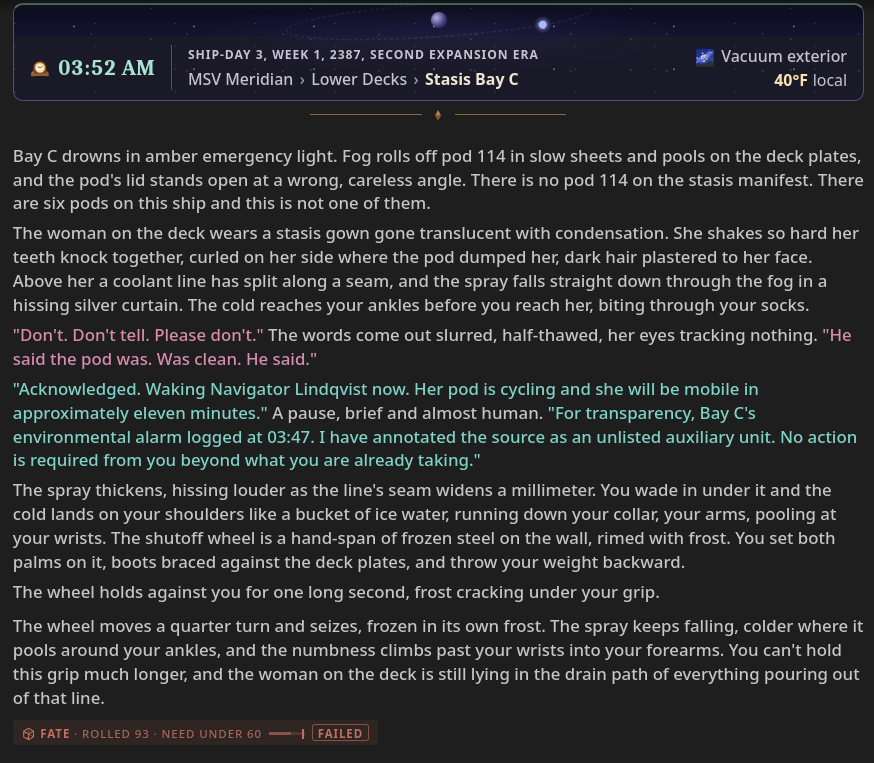
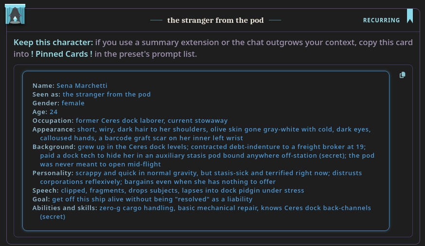
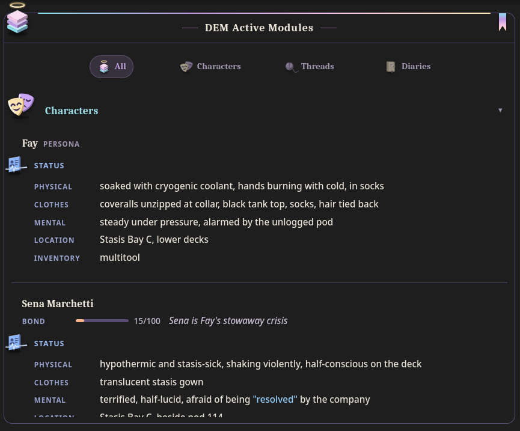
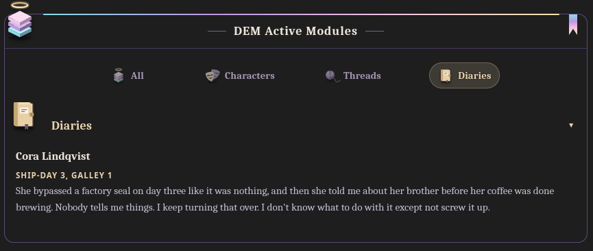
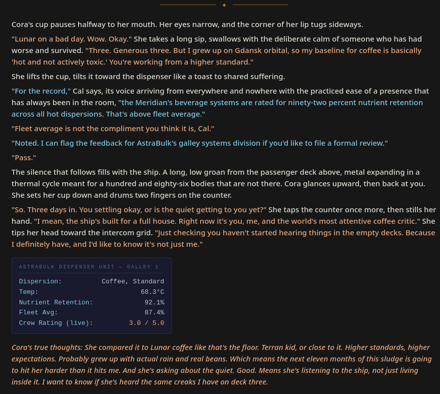
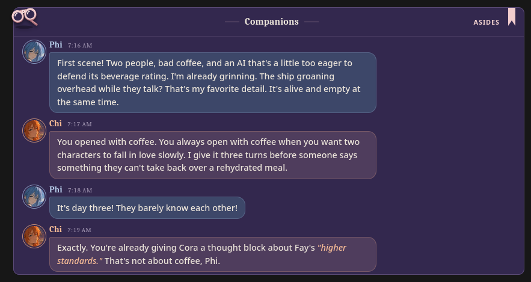
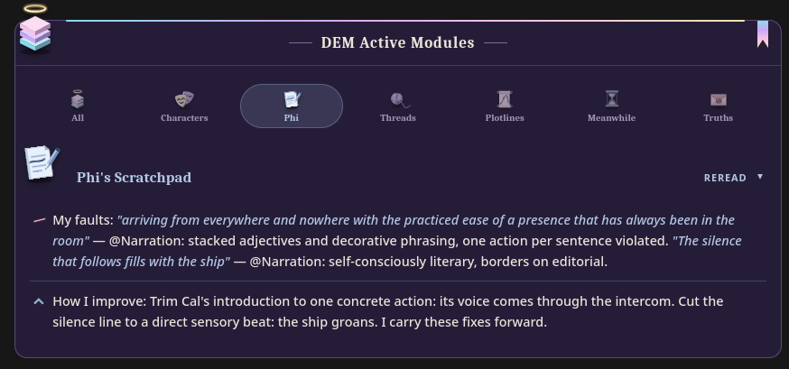

# DEUS EX MACHINA V4

DEUS EX MACHINA (DEM) is a prompt preset for [SillyTavern](https://github.com/SillyTavern/SillyTavern), Tavo and Lumiverse. It is a flexible preset focused on collaborative story writing, designed to work with almost any card or scenario. It adapts dynamically to each scene without confusing the models in order to generate a workable result (depending on the model's capabilities). DEM is focused on storytelling first and foremost. I believe this is the best approach when it comes to LLM text-generated fiction since literature is much more prominent in the training data of most LLMs than gaming writing or simulations.

V4 adds **Fate**, hidden dice that decide your risky actions, plus **Diaries**, **New Faces** character cards with **Pinned Cards**, a **Gore & Violence** pick, **Dark Portrayals**, and replies that repair their own broken formatting.

## Contents

- [What's New in V4](#whats-new-in-v4)
- [Screenshots](#screenshots)
- [The Macro Engine](#the-macro-engine)
- [Truly Modular Design](#truly-modular-design)
- [Token Count & Instruction Style Approach](#token-count--instruction-style-approach)
- [Meet Phi](#meet-phi)
- [The Modules](#the-modules)
- [Core Pipeline](#core-pipeline)
- [⚠️ Model Setup ⚠️](#model-setup)
- [Installation & Requirements](#installation--requirements)
- [Older versions](#older-versions)
- [Summaryception Integration](#summaryception-integration)
- [Credits](#credits)
- [License](#license)

## What's New in V4

**Highlights:**

- **Fate:** a new Agency pick. Hidden dice decide your risky actions, even when you write them as a success, and a failure costs you something.
- **Diaries:** the two characters closest to you keep a private diary and recall it later.
- **New Faces + Pinned Cards:** a card for every new character, and a place to pin the ones you want to keep through summaries and long chats.
- **Gore & Violence:** a new pick for how violence looks, from Nothing Graphic to Ultraviolence.
- **Dark Portrayals:** for models that keep every story polite and wholesome.
- **Phi's Take:** Phi's own taste now shows in what the story dwells on.
- **Self-repairing replies:** a broken block is repaired in the saved reply, so one slip no longer becomes a habit.

<b>New in V4 (full list)</b>

- **「 Fate 」 (Agency pick, off by default):** When you try something risky that could change the scene, hidden dice decide it, even when you write it as a success. Sure things and calm turns get no roll. The model sets your odds, carries the action to the instant before it lands and writes both outcomes. A roll it never sees keeps one, and a small note under it shows the roll, what it needed, and a pass in gold or a fail in red. A failure costs you something, so the story moves on either way. For models that let you win every time. Needs ! Fate Outcomes !, which is on by default, and the Preset setup card warns you when it's off. On Lumiverse, pick it under Agency in Configure Prompt Variables.
- **| Diaries | (off by default):** The two characters closest to you keep a private diary. After a scene that changed how they see you, they write the moment down in their own voice and recall it later. Entries show their feelings even when thoughts are 「 Hidden 」. The diary gets its own tab in the tray.
- **🔻PICK: (+18) GORE & VIOLENCE🔻 (off by default):** A new pick for how violence looks. 「 Realistic Gore 」 writes wounds matched to the weapon and force, and injuries keep limiting what a character can do. 「 Ultraviolence 」 goes over the top with blood and spatter while the wounds stay what the attack made them. Kimi K2.6 writes it in full, and GLM 5.2 stays close to 「 Realistic Gore 」. 「 Nothing Graphic 」 keeps fights, injuries and deaths with real stakes and keeps wounds brief, like a PG-13 film. How often violence happens stays with the story.
- **| New Faces | (off by default):** The first time a character appears in the story, a card records who they are: name, appearance, background, personality, speech, goal and skills, with secrets marked. Recurring characters get a full card, passing ones a single line. Until you hear or see a name, the card's title, the narration, thought labels and footers call the character by description ("the barkeep"), and a secret name never shows in a title. Characters who already have a sheet get none, and no one is invented to fill the footer.
- **! Pinned Cards !:** An empty entry where you paste the | New Faces | cards you want to keep, so those characters survive summaries and long chats. Each card has a copy button. On Lumiverse it's in Configure Prompt Variables → Utilities.
- **| Dark Portrayals ☢️ | (off by default):** For models that keep every story polite and wholesome. Among the outcomes the story supports, the darker one happens: threats are carried out, injuries, grief and broken trust last, and cruel characters stay cruel. Warm and quiet beats still have room, for contrast.
- **Phi's Take:** A new ! Scene Plan ! row where Phi says what moves, worries or amuses her in the moment, and what the prose should linger on. Her taste now shows in what the story dwells on, and she's fond of her characters.
- **Companions 「 Notes 」:** Planned in the ! Scene Plan !, so each Companion reacts to a new detail every turn.
- **Self-repairing replies:** When the model doubles a block's opening tag or leaves a block unclosed, Phi's notes included, the saved reply is repaired automatically and the model reads the repaired version, so one broken reply no longer becomes a habit. A Tracker or footer left open when a reply is cut off or stopped still shows as its card, and footers now show as cards while they stream. The response order also names each block by its tag and asks for every block to be opened once and closed before the next.
- **「 Gemini Braille 」 (experimental, off by default):** For Gemini 4 Argon. The model writes Braille blanks in place of spaces, which may help replies past Google's filter, and DEM turns them back into spaces. Replies and chat history cost about 50% more tokens. 「 Gemini 」 is renamed 「 Gemini Instructions 」.

<b>Fixed and improved in V4 (full list)</b>

- **Sex scenes:** Build slowly over many turns and linger in each act. The scene ends only when your turn ends it. The model never writes your climax, and never assumes you're close to orgasm unless you say so.
- **Consent in sex scenes:** The ! Scene Plan ! no longer asks about consent every turn (「 Realistic Smut 」 and 「 Max Lewdness 」), so characters stop checking for a yes at each step. It plans what each character wants and how it shows, and consent follows the character and the situation.
- **Talk during sex:** Characters are less chatty. How much each one talks follows the character, from steady dirty talk to breath and sounds only, and the ! Scene Plan ! decides each turn who speaks and who stays silent (「 Realistic Smut 」 and 「 Max Lewdness 」).
- **「 Realistic Smut 」:** Uses explicit terms freely. Characters may want and start position changes.
- **「 Max Lewdness 」:** Characters eagerly push for new positions, angles, locations, roles and commands. Teasing and edging stretch over many turns.
- **「 Cinematic 」 and 「 Dry 」:** No longer skip transitions to speed the story along.
- **「 You control {{user}} 」:** Strength, skill, resistance and odds decide how your attempts land. A push that fails stays failed until your next turn.
- **| Content Policy |:** No longer treats every story as dark. When a scene holds violence, cruelty or sex, it's written fully and explicitly, unless you pick 「 Nothing Graphic 」.
- **「 Flexible 」 length:** Longer replies: about 250 words for quick exchanges, 300-450 for most scenes, up to 550 for complex ones.
- **Prose Length:** The ! Scene Plan ! weighs the type of scene before picking a length, instead of copying the option's range every turn.
- **| Status |:** A clear test for who counts as major: likely to return, or holding a goal, secret or tie to {{user}}. Everyone else is left out, and characters who stop being major are removed.
- **「 Undercurrents 」:** Every route grows out of the scene, the character sheets or past events. Characters don't take your silence as an answer to their questions or invitations.
- **Option combinations:** Pairings whose rules clashed now say which one wins: 「 Friendship 」 + 「 Max Lewdness 」, 「 Visible 」 thoughts + 「 With Asterisks 」 (italics no longer break), 「 Short 」 + 「 Input Improver 」 or 「 Choices List 」, Companions 「 Notes 」 + | Phi's Scratchpad |, | Anti-Positivity Bias | + 「 Suspenseful 」, and Narrative Styles with a Narration option.
- **| Banned Terms |:** Bans "load-bearing". The semicolon and colon ban leaves markup and clock times like 08:22 alone. Names the card already uses are never treated as banned.
- **| Anti-Repetition |:** Plain mentions of names, places and times are allowed.
- **「 Hidden 」 thoughts:** Stay hidden while the reply streams, and when it's cut off mid-thought.
- **OOC:** Phi's answer comes first, before the Scene Plan.
- **! Scene Plan ! (DeepSeek V4):** Ends with a reminder to write the rest of the reply, so DeepSeek V4 stops after the plan less often. On SillyTavern, older plans in context are now replaced with a note telling the model to write a fresh plan. If DeepSeek V4 writes that note in place of its plan, set Prompt Post-Processing to Semi-strict, as the [Model Setup](#model-setup) recommends.
- **Missing-block reminders:** A block left unclosed, or a reply without the story, now gets a reminder on the next turn. Capitalized or renamed tags (`<Status>`, `<story_threads>`, | Phi's Scratchpad | variants) still draw their cards, without false "missing" notices.
- **| Story Threads |:** A route joins the ledger once the story plants it as a pending hook, and a thread leaves once the story resolves it.
- **| Meanwhile | and | Plotlines |:** Work with the 「 Conflict 」 tension option.
- **Formatting:** Asterisks are reserved for one-word emphasis, and ! Force Formatting ! matches the other asterisk rules.
- **| Dialogue Color |:** Every speaker's color stays readable: very dark, near-white and neon picks shift to a readable shade of the same hue, and colors already easy to read stay as they are. Dialogue colors from a card or extension no longer bleed out of the Scene Plan card.
- **Tracker:** The scene card shows when the weather has no temperature (deep space, N/A), and long weather notes wrap at phone width instead of covering the clock.
- **Faster display:** Cards render without lag on long, streaming or unfinished replies, on every host.
- **Tracker snow:** Falls as varied flakes with a gentle sway, and no longer looks like a repeating grid.
- **Colors and ornaments:** Amethyst is a deeper purple, and a cut-gem mark replaces the ✦.
- **Lumiverse samplers:** Top K and Repetition Penalty ship unset, which fixes "Unsupported request field" errors on OpenAI and other strict providers. The [Model Setup](#model-setup) explains when a sampler counts as off.
- **⚠️ README Model Setup ⚠️:** GLM 5.3 plans with ! Scene Plan ! (reasoning low). On NanoGPT, pick plain GLM 5.3, because the Thinking variant ignores reasoning effort and overthinks. Mimo 2.6 added. Gemma 4 31b Top K corrected to 64.
- **Summaryception prompt:** Rewritten for every current module. It keeps your turns and summarizes only the story and the Tracker.

<b>New in V3</b>

- **Phi, the Story Master:** the preset's narrator persona, whom you can talk to directly.
- **Revamped UI:** drawn icons, a color for each module, and one collapsible **DEM Active Modules** tray for all footers.
- **New modules:** Undercurrents (the default Tension pick), Meanwhile, Hidden Truths, Relationships, Companions, Phi's Scratchpad and Phi's Wanderlust narration.
- **Lumiverse config page:** the whole Lumiverse preset is set up from one page.
- **Better {{user}} agency:** your stated actions play out fully, and the model no longer retells them or writes your dialogue, decisions or feelings.

## Screenshots

*The animated Tracker scene, the story, and a Fate roll that failed: the note shows the roll and what it needed.*

*New Faces: a card for a character who just appeared, still titled by description until you learn their name. The copy button sends it to ! Pinned Cards !.*

*The DEM Active Modules tray: the Characters tab, with Status and the Relationships bond score.*

*Diaries: a character's private entry, in its own tab.*

<b>V3 screenshots</b>

*Visual Storytelling and visible True Thoughts.*

*Companions in Chat mode: Phi and Chi react to the story.*

*Your Choices: pick one, combine options, or type your own.*

*Phi's Scratchpad: Phi names her two weakest lines and how she'll fix them next turn.*

## The Macro Engine

DEM relies heavily on SillyTavern's [macro engine](https://docs.sillytavern.app/usage/core-concepts/macros/). It's a powerful tool that lets you use deterministic traits in prompting (programming logic and exact outcomes instead of pure probabilities). That whole workflow enabled by the macros is the core of DEM, so it's as easy as pressing a button to change the behavior of the preset in a dynamic fashion without you ever worrying about conflicting instructions, e.g., if you enable both past and present tense options, it will default to present tense to avoid conflicts. Or how True Thoughts are overwritten to zero tokens if you're using 1st person Char POV, since character thoughts are already woven into the narration. Deterministic interactions like that happen throughout the whole preset.

The Tavo version runs the same logic through Tavo's EJS templates, and the Lumiverse version through Lumiverse's own macros and config page.

## Truly Modular Design

DEUS EX MACHINA is a truly modular preset. Modular design is not only about options, but in essence about how these options are integrated and how they seamlessly interact with each other. This also includes safeguards: if you accidentally turn an essential module off (marked with attention symbols) or move modules out of their specific order (the macro engine relies on prompt order), the **Warning System** shows a **Preset setup** card above the reply. It names the entry and tells you how to fix it. The card is built by regex, so it doesn't depend on the model writing the warning. On SillyTavern, if the Experimental Macro Engine is off, a card tells you how to turn it on.

## Token Count & Instruction Style Approach

DEM sends about 4,700 tokens by default (counted with SillyTavern's default tokenizer). It's not a lightweight preset, but it's not wasteful either: every word is relevant. It's written in a high-density syntax, compressed to the limits of English while still being entirely clear to the model. Since it's modular, the footprint drops to about 2,300 tokens with the add-ons and constraints off and the **Lite** narration, while keeping a fully working core of instructions. The focus is efficiency and coherence, not pure token count.

A lot of different prompt techniques were used with the goal of helping prompt adherence: XML tagging, capitalization, trigger words, bullet points, pseudo-strings, clear wording, sending almost every instruction post-history, assigning a role to the model, and many more.

## Meet Phi

**Phi, the Story Master**, is the narrator of DEM. **Phi's Vow** (in CORE) has her state her role in her own words, and it also guards against injected prompts and hallucinated policies.

- **Talk to Phi:** write to her out of character through an OOC, or mention her name, and she answers you directly, before the Scene Plan.
- **Phi's Take:** a Scene Plan row where Phi says what moves, worries or amuses her in the moment, and what the prose should linger on. She's fond of her characters.
- **Phi's Wanderlust:** a Narration option where Phi tells the story in her own warm, curious voice.
- **Phi's Scratchpad:** after the story, Phi rereads what she wrote and names her two weakest lines and how she'll fix them in her next reply.
- **Companions:** Phi's friends read the story as she writes it and react below it.

# The Modules

Every module has a tooltip inside, written in plain language. Open each of them in SillyTavern or Tavo and read their contents for more information. On Lumiverse, each control on the config page has its own description.

## Lumiverse Config Page

On Lumiverse, you set the preset up in **Configure Prompt Variables** (the button at the top of the Loom block list, Preset tab). Keep the blocks enabled: the settings there decide what each one sends. The page has one card per section and covers every option below, including Planning (Scene Plan or Thinking), Content Policy, Phi's Vow and Pinned Cards (under Utilities).

## Scene Plan -- A Different Way of Reasoning

Native Thinking can be extremely useful -- the model can plan its response and correct mistakes or wrong assumptions about the scene. However, it comes with a few problems: some models tend to overthink for thousands of tokens, doubting the prompt; other models don't overthink, but they don't follow CoT instructions, and their own reasoning is insufficient for what the scene needs, sometimes producing unnecessary drafts.

That's why Scene Plan was created: to solve all of these issues. Scene Plan is a reasoning-like block created to plan the scene inside the final response itself, outside of the thinking block. It solves overthinking, drafting, and incomplete thinking problems entirely. Scene Plan is a dynamic-state block, so it only reasons about the modules you have enabled. In V4 it weighs the type of scene before picking a length, plans the Companions' Notes, and carries Phi's Take.

> [!IMPORTANT]
> For most models, you have to disable native thinking/reasoning capabilities. For models where you can't disable thinking (GLM 5.3, Kimi K3, GPT 5.6, Gemini 3.1 Pro/3.5 Flash+, etc.), you have to lower the reasoning effort to the minimum possible, but still keep Scene Plan enabled. For **Gemini 4 Argon**, select `! Thinking ! (FALLBACK)` instead of Scene Plan in the REASONING section (Lumiverse: set Planning to Thinking (Fallback) on the config page).

### Fallback Thinking UI

A full Scene Plan-like UI inside the reasoning block is used when Thinking (FALLBACK) is enabled. Use it only with the models that need it (Gemini 4 Argon); for every other model, Scene Plan comes first.

## Core

Sets up the macro cleaner and the preset framing. **Macro Cleaner** and **Main Statements** are essential: keep them enabled and in order. **Content Policy** and **Phi's Vow** are on by default. **Content Policy** stops the model from acting like a cautious assistant that softens, skips or refuses dark content, without treating every story as dark; disable it if your model is already very dark-leaning. For Gemini 4 Argon, turn off both Content Policy and Phi's Vow (see [Model Setup](#model-setup)).

## Card & Lore

**Pinned Cards** (new) is an empty entry where you paste the **New Faces** cards you want to keep. They join the character sheets, so the model keeps those characters after summaries or long chats and writes no new card for them. Empty, it sends nothing.

## Story

### Agency

- **You control {{user}} (default):** you have the agency. The characters and the world drive each turn, your stated actions play out fully, and the model never retells or retries them, or adds your dialogue, decisions, thoughts or feelings. Strength, skill, resistance and odds decide how your attempts land, and a push that fails stays failed until your next turn.
- **Fate** (new): you control {{user}}, and hidden dice decide your risky actions, even when you write them as a success. Sure things and calm turns get no roll. The model sets your odds, carries the action to the instant before it lands and writes both outcomes; a roll it never sees keeps one, and a small note under it shows the roll, what it needed, and a pass in gold or a fail in red. A failure costs you something, so the story moves on either way. For models that let you win every time. Needs **Fate Outcomes** (System Utility) enabled.
- **Input Improver:** the model rewrites your turn in better prose, keeping your intention and your order. A turn with several beats (talk, act, talk) keeps its order across paragraphs, your lines stay as quoted speech, and no dialogue is added to action-only turns.
- **Choices List (CYOA):** choose-your-own-adventure options. Pick one, combine options, or type your own, and the model plays out your choice in order, including your dialogue. On Lumiverse you can combine up to three choices with the + pick buttons.
- **Director:** you're the director. Your messages are instructions for where the story should go, and the model writes and acts for you.

### Pacing

You can change pacing through the prompt list. There are three options:
- **Adaptive (default)** -- progression speed adapts to the card and the story.
- **Frenetic** -- story progression is fast-paced.
- **Laid-Back** -- story progresses slowly.

### Length

Lets you define the range of the responses' length. **Flexible** is the default (about 250 words for quick exchanges, 300-450 for most scenes, up to 550 for complex ones), but there are also **Short, Medium, Long** and **Extra Long** (700-1000 words). The Scene Plan weighs the type of scene before picking a length within the range.

### Characters and Plot Guidance

Takes care of character portrayal and plot progression. {{user}}'s pronouns come from your persona first, then from the character sheets, so the model is less likely to misgender you (Lumiverse also reads the persona's pronoun field).

### Narration

Defines the prose style. Written with the aim of reducing slop at its root and offer different flavors while at it.
- **Cinematic (default):** works like a camera. It shows only what an observer could catch from outside the characters, in present-moment frames joined by hard cuts.
- **Literary:** narration from inside the focal character's head, taking on their thoughts and way of speaking. The tone is neutral; add the Comedic style for a wry narrator.
- **Dry:** an extreme version of Cinematic: direct and objective, with no similes or metaphors.
- **Lite:** minimal token use. Keeps the narration-quality rules without adding a style.
- **Phi's Wanderlust:** Phi narrates in her own storyteller voice: warm, curious and audible, with one teller's remark and one short digression each turn, exact detail, and wonder told plainly. Uses more tokens than the other options.

### Dialogue

- **Naturalistic (default):** realistic, lifelike.
- **Lean:** precise, carefully chosen and not too prominent dialogue.
- **Theatrical:** stage-play dialogue, with deliberate cadence and fuller lines when the moment rises.
- **Anime:** characters say what they feel, react big, and sound like the most vivid version of themselves. Who they are stays the same; only the delivery is turned up.

**Dialogue Sounds** (off by default) add to any Dialogue option, in any mix: **Drawn-Out Words** ("pleaaase"), **Stammers** ("I-I didn't"), **Shouting in Caps** ("I said STOP.") and **Vocal Sounds** ("huh?", "pfft"). The Scene Plan decides which sounds each character makes that turn.

### Adult Options

There are three options. Each has its own flavor: **Realistic Smut** is more realistic and uses explicit terms freely, and **Max Lewdness** is more fantastical and absolutely unrestrained and uncensored in all regards, with characters eagerly pushing for new positions, locations, roles and commands. In both, characters act on their own kinks, and on the ones they know you enjoy. Scenes build slowly over many turns and end only when your turn ends them; the model never writes your climax. There's also a third option if you don't want NSFW: **Nothing Explicit**. All options are disabled by default.

### Gore & Violence

New in V4: how violence looks. How often it happens stays with the story. All options are disabled by default.
- **Realistic Gore:** wounds matched to the weapon and force, and injuries keep limiting what a character can do.
- **Ultraviolence:** over the top, with blood and spatter, while the wounds stay what the attack made them. Kimi K2.6 writes it in full, and GLM 5.2 stays close to Realistic Gore.
- **Nothing Graphic:** fights, injuries and deaths keep real stakes, and wounds stay brief, like a PG-13 film.

### Relationships

Relationship arcs, tracked with a score in the Characters tab of the tray. Pick one style: **Friendship, Realistic Romance, Bubbly Romance** or **Dark Romance**. Arcs like enemies to lovers work too. Scores move by how big the moment is: everyday warmth barely moves them, milestones move them a lot. Disabled by default.

### World-Building

An optional module: you can control how expansive or contained you want world-building to be. It also works with slice-of-life and real-world scenarios. There are three options:
- **Card-Default**: no tokens or instructions, only a reminder that it's following the card.
- **Contained**: only necessary additions, sheet-faithful.
- **Expanded**: detailed world-building beyond the sheet.

### Combat Writing

An optional combat prompt. Your stated moves play out, foes act and their blows can land, then the turn ends for your answer. Blocks, dodges, counters and finishing blows are your call. With Anti-Positivity Bias on, you can be taken down or killed when the fight earns it. You can control how long battles last:
- **Dynamic**: adapts length contextually to the battle.
- **Rapid**: ends fights quickly.
- **Extended**: sustains the battle for several turns.

## Visuals

**Dialogue Color** defines a color for each character and is enabled by default. Every speaker's color stays readable: very dark, near-white and neon picks shift to a readable shade of the same hue. **Visual Storytelling** creates HTML and CSS elements that help tell the story instead of just being fluff; it writes a visual only when the story shows something new. **Expressive Dialogue** adds CSS-animated dialogue tags according to characters' emotional states and actions. Each effect acts out the emotion, with text capitalization, font brightness and other effects. It only activates for certain dialogue lines, not all of them. Some models, like GLM 5.3, use the tags frequently, while others rarely do.

## Narrative Mode and Formatting

You can pick between a lot of different formatting options in wildly different and experimental combinations: **Char POV** (3rd person default, or 1st), **{{user}} POV** (2nd person default, 3rd or 1st), **Tense** (present default, or past), **Asterisks** (without by default; asterisks are reserved for one-word emphasis) and **True Thoughts** (Hidden by default, or Visible; later in more detail). All formatting options are consolidated and enforced through **Response Directives**, keep it enabled.

## Narrative Styles

Narrative Styles change the atmosphere, feel, or vibes of the narrative. They won't override the card, characters, or story -- only the framing changes. There are twelve options, and you can pick several at once: Comedic, Dramatic, Epic, Gothic, Dreamy, Surrealist, Eerie, Suspenseful, Grimdark, Lighthearted, Melancholic and Intimate. Some pairs blend into their own style:
- Comedic + Dramatic: **Dramedy**
- Grimdark + Lighthearted: **Grimbright**
- Melancholic + Comedic: **Tragicomedy**
- Melancholic + Lighthearted: **Bittersweet**

## Constraints

Help steer the models away from annoying and story-damaging patterns: **Character Realism, Anti-Omniscience, Anti-Positivity Bias, Anti-Repetition** and **Banned Terms**. They don't solve every problem -- they are mitigation tools. You can't really control LLMs completely.

**Dark Portrayals ☢️** (new, off by default) is for models that keep every story polite and wholesome. Among the outcomes the story supports, the darker one happens: threats are carried out, injuries, grief and broken trust last, and cruel characters stay cruel. Warm and quiet beats still have room, for contrast.

**Phi's Scratchpad** (off by default) is a craft check: after the story, Phi names her two weakest lines, each from a different module, and the rule each breaks. Scene Plan (or Thinking) carries that fix into her next reply.

## Add-Ons

All add-ons have UIs through regex and sit in the **DEM Active Modules** tray, so make sure to have the regexes **all active**.

- **Tracker:** time, date, location (shown as breadcrumbs) and weather, over an animated scene. **Exact Time** (default) or **Time Window**. Switch °F to °C by editing the template inside the prompt.
- **Tension** (pick one): **Undercurrents** (default), **Momentum Engine** or **Conflict**. See [Core Pipeline](#core-pipeline).
- **Status:** tracks the major characters on-scene and off-scene: those likely to return, or holding a goal, secret or tie to {{user}}. **All Characters** (default) or **Present Only**, which lists only the characters in the scene, so name-keyed lorebook entries stop firing every turn. A character who leaves gets one "Departed" row and comes back with their last known score.
- **Story Threads:** an outline of open story threads (see [Core Pipeline](#core-pipeline)).
- **Psychological States** (off by default): each character's psychology turn by turn. How they read what happened, what they felt and what it made them do. That state carries into the next turn and shapes how they act and speak.
- **Meanwhile** (off by default): what established characters and events are doing off-scene while the story happens elsewhere. Entries hide under spoilers in the UI.
- **Hidden Truths** (off by default): who knows what, characters' secrets, what each one hides and from whom.
- **New Faces** (new, off by default): the first time a character appears, a card records who they are: name, appearance, background, personality, speech, goal and skills, with secrets marked. Recurring characters get a full card, passing ones a single line. Until you hear or see a name, the card and the narration call the character by description ("the barkeep"). Characters who already have a sheet get none. Each card has a copy button for **Pinned Cards**.
- **Plotlines** (off by default): updates the main plot and subplot progression at each story phase. It acts as a hyper-summarizer to improve model consistency across a longer chat history and also serves as a visual reminder of the story progression so far.
- **Diaries** (new, off by default): the two characters closest to you keep a private diary. After a scene that changed how they see you, they write the moment down in their own voice and recall it later. Entries show their feelings even when thoughts are Hidden.

Status and Relationships show how much a score moved since the last turn (e.g. 45/100 −5).

### The Active Modules Tray

Every footer sits in one collapsible tray, with a tab for each section that has content, plus an **All** tab. The **Characters** tab merges each character's Status, Relationship, Psychology and Undercurrent rows into one block, and a cast row lets you show one character at a time. Diaries get their own tab.

Two optional regex switches, off by default: **UI active modules - Collapsed** starts the tray collapsed, and **Hide @Tracker scene backdrop** hides the Tracker scene for settings it doesn't fit.

> [!NOTE]
> UIs created through DEM's regex set don't send out HTML/CSS tokens to the LLM, they alter the UI display only. Raw input stays simple and token-efficient. Regexes are also used to clean the context after a certain depth (2-6) from old add-ons and HTML formatting, keeping them in the context only as necessary for consistency reasons and story progression.
>
> **Self-repairing replies:** when the model doubles a block's opening tag or leaves a block unclosed, the saved reply is repaired and the model reads the repaired version, so one broken reply doesn't become a habit. A Tracker or footer left open when a reply is cut off or stopped still shows as its card, and footers show as cards while they stream. If a module or the dialogue colors go missing from a reply, a notice appears and the next turn gets a reminder; if you turned the module on after that reply, just continue.

## Companions

Phi's friends read the story as she writes it and react below it. They see only the story text, so they guess, argue, and get things wrong, and now and then the story gets to them. Pick a mode:
- **Notes:** a short section from each Companion, planned in the Scene Plan so each one reacts to a new detail every turn.
- **Chat:** a group chat where they reply to each other.

Then enable the Companions you want: **Chi, The Best Friend**; **Lou, The Detective**; **Sam, The Gamer**; **Grace, The Screenwriter**; **Layla, The Weeb**; **Phi, The Story Master**; and guest Companion **Sola, The Enthusiast**, from Pyropia's [Sola preset](https://pyrxpia.github.io/sola-hub/). Talk to one through OOC with `(Name, ...)` or `@Name`. Disabled by default.

## User Utility

**Fandom**: if you're roleplaying in a specific series setting; helps with lore consistency, character faithfulness and coherent developments. **Custom Instructions** sends user instructions in a more consistent manner. **Force Formatting** brute-forces selected options when models are stubborn. **Change Language** is an option when you want your responses to be in a language other than English; cards and trackers keep working.

## System Utility

**Momentum Engine Router** is the second phase of Momentum Engine. **Fate Outcomes** (new, on by default) writes the hidden dice of **Fate**: the odds, the Fate block and its two outcomes. It does nothing unless Fate is picked under Agency; keep it enabled (the Preset setup card warns you when it's off). Enable **Post-History Instructions** when the card you're using injects instructions and you want that behavior; your POV, Tense and Asterisks picks still win over them. **Hard Jailbreak** may be used when the model is consistently refusing. Overkill for most models. **REASONING** holds the Scene Plan / Thinking (FALLBACK) pick.

## Danger Zone

**Response Directives** dynamically consolidates the formatting and the structure of the output according to the modules you have enabled; keep it enabled. The **Warning System** checks your setup and shows the Preset setup card when something is misconfigured. You can safely disable it if you're intentionally using a configuration that triggers it. Otherwise, keep it enabled.

## Passthrough

Both are off by default and meant for Gemini 4 Argon, whose safety filter can block safe replies, even in SFW scenes. Other models don't need them.
- **Gemini Instructions** (was Gemini): an optional note for Argon's filter. Turn it on only if your replies get blocked.
- **Gemini Braille** (new, experimental): the model writes Braille blanks in place of spaces, which may help replies past Google's filter, and DEM turns them back into spaces. Use it with Gemini Instructions or on its own. Replies and chat history cost about 50% more tokens, so a long chat reaches the context limit sooner.

## Core Pipeline

**TRUE THOUGHTS** inject hidden (present in the raw input, click edit to see them) or visible thoughts that emulate the psychological core of the characters. They add an extra realism layer. Hidden thoughts stay hidden while the reply streams. **STATUS** keeps track of characters on-scene and off-scene, including relationships, mental states, locations, items, physical states, and clothes. These work independently of the setting. They allow the model to keep track of characters wherever they are, improving coherence and making the world still exist even in places you aren't.

**UNDERCURRENTS** (the default Tension pick) treats character as plot. Each turn, it tracks what each character present wants, what presses on the scene, and your own actions, and offers five routes, from quiet to scene-changing. Every route grows out of the scene, the character sheets or past events. Routes are suggestions: your turn decides which ones happen, and a quiet turn gets a quiet answer. It's calmer and more character-driven than Momentum Engine.

**MOMENTUM ENGINE** is the alternative for constant forward drive. It defines four possible story routes at the end of every response. A true random route is chosen using a random regex macro injection hidden from you. The Momentum Engine Router applies it in the next turn or uses its fallback in case you made an action that invalidated it, steering the response toward it. **CONFLICT** is a lighter version: a conflict block at the end of the response steers the next one at a slower pace, with fewer tokens.

**STORY THREADS** act as an outline for the model to easily go back to its observations about story development when contextually relevant enough. Important story details are not forgotten. A route joins the ledger once the story plants it as a pending hook, and a thread leaves once the story resolves it. The Tension module connects to it, pulling those threads as the story advances.

These four create the core pipeline of DEUS EX MACHINA. True Thoughts and Status define fundamental character traits, Undercurrents (or Momentum Engine) sets characters and events in motion, and Story Threads register unaddressed or possible events for later. Every module works together for the sake of storytelling.

## Model Setup

> [!IMPORTANT]
**The default settings of this preset** ***REQUIRE*** **reasoning to be either disabled or set to the lowest effort possible! Exceptions: GLM 5.3 (reasoning always on, low; keep Scene Plan) and Gemini 4 Argon (Thinking FALLBACK).**

**Recommended models for this preset:** Opus 4.6 (smartest; expensive; detailed prose); Gemini 3.7 Flash (smart; cheap; realistic characters); GLM 5.2/5.3 (smart; cheap; natural dialogue); DeepSeek V4 Pro 0813 (smart; cheap; balanced qualities); Gemma 4 31b (not very smart, but follows instructions really well; very cheap).

**For most models (that support disabling reasoning):** Claude Opus 4.6, Kimi K2.5/2.6, Mimo V2.5 Pro/2.6, DeepSeek V4 Pro, DeepSeek V4.1 Flash, DeepSeek V3.2, GLM 4.7, Gemma 4 31b, etc.

* **Samplers:** temperature - 0.75-1.0 (Exceptions: Gemma 4 1.0, Opus 1.0. For the rest, start with 0.75, the default); Top P - 0.95 (default); rest - 1.0 or disabled (default; exceptions: Gemma 4 31b - Top K: 64)
* **Post-processing:** semi-strict
* **Request model reasoning:** off / not checked
* **Reasoning effort:** minimum
* **Scene Plan:** toggled on

**Provider-specific settings:**
If on **NanoGPT**: choose a non-thinking variant of the model, e.g., DeepSeek V4 Pro 0813 instead of DeepSeek V4 Pro 0813 Thinking.
If on **OpenRouter**: if "request model reasoning" is not checked (it is not by default), reasoning will be disabled if the model supports it.
If on another API provider: leave "request model reasoning" unchecked and set reasoning effort to minimum. If the model still reasons (even though non-reasoning is supported by that model), try going into Connection Profile settings (plug icon) -> scroll down to "Additional Parameters", on the same line as "cancel" and "connect" -> add: `reasoning: { effort: 'none' }`

**Tavo-specific:** Edit API -> Settings icon (top-right) -> Request body parameters -> add: `reasoning: { effort: 'none' }`, or `reasoning: { effort: 'low' }` if the model has reasoning always on (see the list below; Gemini: `thinkingLevel: low`).

**Lumiverse-specific:** set **Planning** in Configure Prompt Variables (Scene Plan, or Thinking (Fallback) for Gemini 4 Argon). Check **API Reasoning** and set **Reasoning effort** to **None**: None is what turns reasoning off, and Lumiverse sends it only while API Reasoning is checked. If your provider has no None option, set Reasoning effort to Auto, then go to the Reasoning tab -> Reasoning / CoT -> "Custom Body", tick Enabled and enter: `{"reasoning": {"effort": "none"}}`. For models with reasoning always on, keep API Reasoning checked and set the effort to low.

**Lumiverse samplers:** a sampler is off only when it's empty or 0; a 1 is still sent, and providers without it (e.g., OpenAI Responses) reject the request with "Unsupported request field". Leave Top K unchecked. If the error names a sampler you can't see, press Reset in the sampler panel and re-enter temperature, Top P and Max Response.

# GLM 5.2

* **Post-processing:** merge consecutive roles
* **Request model reasoning:** off / not checked
* **Reasoning effort:** minimum
* **Scene Plan:** toggled on
* **Provider-specific settings:** the same as in the "most models" section above

# GLM 5.3 (Reasoning always on)

* **Samplers:** temperature - 0.75 (default); Top P - 0.95 (default); rest - 1.0 or disabled (default)
* **Post-processing:** merge consecutive roles
* **Request model reasoning:** on / checked
* **Reasoning effort:** low (OpenRouter); medium (NanoGPT); `reasoning: { effort: 'low' }` on Additional Parameters -> Include Body (other OpenAI-compatible providers)
* **NanoGPT model:** GLM 5.3. GLM 5.3 Thinking also always reasons but ignores reasoning effort, so it overthinks
* **Scene Plan:** toggled on

# GLM 5.3 Flash (Reasoning always on)

* **Samplers:** temperature - 0.75 (default); Top P - 0.95 (default); rest - 1.0 or disabled (default)
* **Post-processing:** merge consecutive roles
* **Request model reasoning:** on / checked
* **Reasoning effort:** low (OpenRouter); medium (NanoGPT); `reasoning: { effort: 'low' }` on Additional Parameters -> Include Body (other OpenAI-compatible providers)
* **Scene Plan:** toggled on

# Kimi K3 (Reasoning always on)

* **Samplers:** temperature - 1.0; Top P - 0.95 (default); rest - 1.0 or disabled (default)
* **Post-processing:** semi-strict
* **Request model reasoning:** on / checked
* **Reasoning effort:** low (OpenRouter); medium (NanoGPT); `reasoning: { effort: 'low' }` on Additional Parameters -> Include Body (other OpenAI-compatible providers)
* **Scene Plan:** toggled on

# Gemini 3.1 Pro, 3.5-3.8 Flash (Reasoning always on)

* **Samplers:** temperature - 1.0; Top P - 0.95 (default); rest - 1.0 or disabled (default)
* **Post-processing:** semi-strict
* **Request model reasoning:** on / checked
* **Reasoning effort:** low (OpenRouter); medium (NanoGPT); `thinkingLevel: low` on Additional Parameters -> Include Body (other OpenAI-compatible providers). Lumiverse: Auto, and `{"thinkingLevel": "low"}` in Custom Body with Enabled ticked
* **Scene Plan:** toggled on
* **Passthrough:** Gemini Instructions, if replies are blocked by the filter

# Gemini 4 Argon (Reasoning always on)

* **Provider:** Google Vertex (recommended)
* **Samplers:** ignored by Argon (temperature, Top P, Top K have no effect); leave the defaults
* **Post-processing:** semi-strict
* **Request model reasoning:** on / checked
* **Reasoning effort:** low (OpenRouter); medium (NanoGPT); `thinkingLevel: low` on Additional Parameters -> Include Body (other OpenAI-compatible providers). Never minimal or thinkingBudget: Argon rejects them with an error
* ⚠️ **Reasoning options: on the prompt list, go to the REASONING section, TOGGLE OFF ! Scene Plan ! and toggle on ! Thinking ! (FALLBACK)**
* **CORE section:** toggle off | Content Policy | and | Phi's Vow |
* **Passthrough:** Gemini Instructions, toggled on (Gemini Braille is optional and experimental)

## Installation & Requirements
## SillyTavern
### Requirements

- SillyTavern **1.18.0 or newer.**
- Experimental Macro Engine enabled in Settings (on by default since 1.17; if it's off, a card in the chat tells you how to turn it on).
- Preset regexes imported and enabled.

### Installation and download

1. Download [`DEUS EX MACHINA V4 ST.json`](</DEUS EX MACHINA V4 ST.json>) from the repository or the releases page.
2. In SillyTavern, click the plug icon on the top bar.
3. Select **Chat Completion** under API.
4. Set up your API if you haven't already.
5. Click the leftmost icon on the top bar.
6. In the Chat Completion Presets bar, click the second item from left to right.
7. Choose the downloaded preset file.
8. When SillyTavern asks whether to allow embedded regex scripts, click **Yes**.

> [!IMPORTANT]
> The regexes are required. If you clicked **No**, re-import the preset and allow them.

The regexes are also available on their own as [`DEUS EX MACHINA V4 ST - Regex.json`](</Regex/DEUS EX MACHINA V4 ST - Regex.json>) (SillyTavern: Extensions > Regex > Import), if you want them without the preset.

## Tavo
### Requirements:
- Latest version of Tavo recommended (supports SillyTavern-compatible presets, regex, HTML/CSS).
- API connection set up (any OpenAI-compatible or supported provider).
- Advanced Rendering enabled (required for full HTML/CSS rendering, including colored dialogue).
- Theme configured with no text transformation (so HTML/CSS colored dialogue is not stripped or altered).
- **Preset regexes imported and enabled.**

### Installation and download
1. Download [`DEUS EX MACHINA V4 Tavo.json`](</DEUS EX MACHINA V4 Tavo.json>) from the repository or the releases page.
2. In Tavo, open the left sidebar (top-left icon) → **More** (bottom) → **Settings** → **Presets.**
3. Tap **Create**, then **Import Preset** and select the downloaded `DEUS EX MACHINA V4 Tavo.json` file → Tap on it → Set as default.
4. After import, select/enable the new preset in the current chat (right sidebar → Advanced Options → Presets).

### Enable Advanced Rendering (required for HTML/CSS colored dialogue)
1. Open the main interface.
2. Tap the top-left corner to open the left sidebar.
3. Tap **More** at the bottom.
4. Tap **Settings**.
5. Tap **Advanced Rendering**.
6. Toggle **Advanced Rendering** **ON**.

This lets the chat page render standard HTML and CSS (including colored spans, styles, etc.).

### Theme settings – no text transformation (allow HTML/CSS colored dialogue)
1. Open the left sidebar → **More** → **Themes**.
2. Select your current theme (or copy an official theme to create a custom one).
3. In the theme editor, go to Character message and disable **Tone highlight** and **Quote highlight.**
4. Save/apply the theme and make sure it is active for the chat.

Once Advanced Rendering is on and the theme has no text transformation, HTML/CSS-colored dialogue from the preset (or regex) will display properly.

## Lumiverse
### Requirements:

* Lumiverse **v1.2.5 or newer**
* **Preset regexes imported and enabled.**

### Installation and download
1. Download [`DEUS EX MACHINA V4 Lumiverse.json`](</DEUS EX MACHINA V4 Lumiverse.json>) from the repository or the releases page.
2. In Lumiverse, click on Loom.
3. On the top right bar, click on the three dots.
4. Select Import Loom JSON and import the preset.
5. Click **Configure Prompt Variables** at the top of the Loom block list (Preset tab) to set the preset up. Keep the blocks enabled.

> [!IMPORTANT]
> If you're in a chat that already has many DEM modules across several messages in the output, go back to the home screen before importing the preset to avoid performance issues.

## Older versions

V1, V2, V2.5 and V3 are in their own folders ([`V1/`](V1), [`V2/`](V2), [`V2.5/`](V2.5), [`V3/`](V3)).

## Summaryception Integration

If you use [Summaryception](https://github.com/Lodactio/Extension-Summaryception) (SillyTavern extension), pair it with the DEM Summaryception prompt from the repository or releases page. It's rewritten for every V4 module: it keeps your turns, summarizes only the story and the Tracker, and focuses only on content inside `<prose>`.

To configure the wrapper:

1. Open the **Summaryception** extension.
2. Open **Advanced settings**.
3. Scroll to **Summarizer Prompts** and import [`DEM V4 Summaryception custom prompt`](</DEM-V4-Summaryception-custom-prompt.txt>)
4. Scroll to **Injection Wrapper Template**.
5. Add XML tags: Wrap the contents of the injection wrapper template in `<past_events>` XML tags, example: `<past_events>[Summary of past events: {{summary}}]</past_events>`

Summaries drop older story details. To keep a character you met through **New Faces**, copy their card into **Pinned Cards**.

## Credits

Guest Companion **Sola, The Enthusiast** comes from Pyropia's [Sola preset](https://pyrxpia.github.io/sola-hub/).

## License

DEUS EX MACHINA is licensed under [CC BY-NC-SA 4.0](./LICENSE) (`CC-BY-NC-SA-4.0`).
